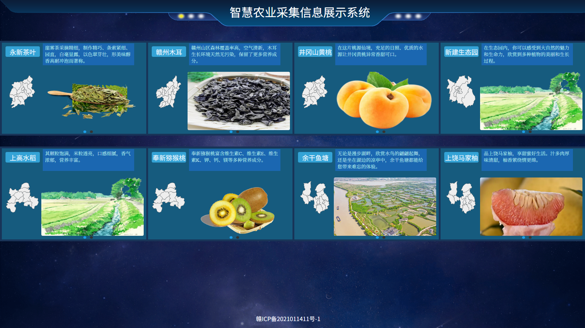

# 智慧农业可视化大屏 · Vue 3 重构版

> 一套面向农业物联网场景的**可视化大屏系统**：16 个基地大屏、实时传感器数据、ECharts 图表、3D 场景与视频监控。
> 本仓库是 **Vue 2 版本迁移到 Vue 3 的重构版本**，包含完整迁移记录与踩坑文档。

🔗 **在线演示**：https://pingguo-lab.github.io/agri-big-screen-vue3/
（后端为 HTTP 接口，HTTPS 页面会拦截请求，因此在线版会自动降级为**示例数据**，控制台会打印 `[mock]`；
本地开发连的是真实网关。）



---

## 项目亮点

| 指标 | 数值 |
|---|---|
| 大屏页面 | 16 个（井冈山黄桃 / 赣州木耳 / 奉新猕猴桃 / 上高水稻 / 新建生态园 / 余干水产 …） |
| 前端代码 | 85 个 `.vue` + 12 个 `.js`，约 5.3 万行 |
| 图表组件 | 29 个（折线 / 柱状 / 雷达 / 风向盘 / 3D 散点） |
| 依赖包 | **1576 → 887**（迁移中删除 9 个冗余或 Vue 2 专用依赖） |
| 生产产物 | 10.8 MB（含 52.8 MB 的图片与模型素材） |
| 技术栈 | Vue 3.4 · vue-router 4 · Vuex 4 · Element Plus 2.7 · ECharts 5 · Three.js · webpack 5 |

---

## 架构

```
┌─────────────────────────────────────────────────────────┐
│ 导航层  views/Home.vue                                   │
│   8 张基地卡片（每张内含一张 ECharts 江西地图）           │
└──────────────────────┬──────────────────────────────────┘
                       │ <router-link>
┌──────────────────────▼──────────────────────────────────┐
│ 大屏层  views/<基地>/ScreenPage.vue（16 个）             │
│   三段式布局：page-top / page-content(left·center·right) │
│                / page-bottom                            │
│   数据流：mounted → 取数 → 赋值 → props 传给图表组件      │
│           setInterval 300s 轮询刷新                      │
└──────────────────────┬──────────────────────────────────┘
                       │ props
┌──────────────────────▼──────────────────────────────────┐
│ 组件层  components/large-cpns/*.vue（29 个图表/视频组件）│
│   只做一件事：收到数组 → ECharts setOption               │
│   components/*.vue（13 个首页卡片）                      │
└─────────────────────────────────────────────────────────┘
```

**数据来源**：农业物联网网关（MQTT → 时序库 → HTTP 接口）。
接口族：`/mountain`（旧）、`/api/v1/msg`、`/api/v1/allMsg`，按 `topicId`（网关号）区分基地。

---

## 迁移做了什么（Vue 2 → Vue 3）

### 1. 语法层（机械替换，脚本化完成）

| Vue 2 | Vue 3 | 处理数量 |
|---|---|---|
| `new Vue({router,store,render}).$mount()` | `createApp(App).use(...).mount()` | 入口重写 |
| `Vue.prototype.$x` | `app.config.globalProperties.$x` | 7 个全局方法 |
| `new VueRouter({mode:"hash"})` | `createRouter({history: createWebHashHistory()})` | 路由重写 |
| `new Vuex.Store({})` | `createStore({})` | 状态重写 |
| `beforeDestroy` | `beforeUnmount` | 26 处 |
| `slot="footer"` | `<template #footer>` | 3 处 |
| `:visible.sync` | `v-model` | 3 处 |
| `this.$set(obj, k, v)` | `obj[k] = v` | 4 处 |
| `Vue.use(组件)` | `app.component(name, 组件)` | 20 处 |
| `require("echarts")` | `this.$echarts` | 12 处 |

### 2. 依赖层（Vue 2 专用库 → 自研兼容层）

| 原依赖 | 问题 | 方案 |
|---|---|---|
| `@jiaminghi/data-view` | 无 Vue 3 版本 | 自研 `compat/data-view.js`（保留组件名与插槽，视觉简化） |
| `vue-awesome-swiper` 3 | Vue 2 插件 | 自研 `compat/swiper.js`（支持原 `:options` 写法） |
| `vue-seamless-scroll` | Vue 2 插件 | 自研 `compat/seamless-scroll.js` |
| `element-ui` | —— | `element-plus` |
| `d3` / `jquery` / `lodash` / `vue-resource` / `require` | 全项目 0 处引用 | 删除 |

兼容层共约 200 行，换来 **23 个轮播文件、11 个边框文件零模板改动**。

### 3. 构建层

- vue-cli 4（webpack 4）→ vue-cli 5（**webpack 5**）
- 删除无用的 `runtimeCompiler`
- `chalk.js`（ECharts 主题）从 UMD 改为 ESM + IIFE，避免 UMD 分支在不同 webpack 版本下行为不一致

---

## 修复的真实缺陷

迁移过程中定位并修复了 3 类问题，都是**原项目里就存在、或在 Vue 3 下才暴露**的：

### ① ECharts 实例被响应式代理 → 图表崩溃

```js
// 现象：Cannot read properties of undefined (reading 'type')
// 原因：Vue 3 用 Proxy 代理对象，class 实例同样被包住，ECharts 内部私有字段访问异常
// Vue 2 用 defineProperty，只处理声明时已存在的属性，所以同一 bug 只在 Vue 3 暴露

this.myChart = markRaw(this.$echarts.init(this.$refs.curve, "chalk"));
```

涉及 29 个图表组件。同理，Three.js 的 `scene/camera/renderer` 也一并 `markRaw`。

### ② 导出接口鉴权头从未生效

```js
// 原代码：全等比较一个与实际请求不一致的 URL，永远为 false
if (config.url == "http://…/api/v1/export")

// 修复：后缀匹配 + 空值判断
const token = localStorage.getItem("token");
if (token && (config.url || "").includes("/export")) config.headers.Authorization = token;
```

### ③ mqtt 在 webpack 5 下无法构建

webpack 5 移除了 Node 内置模块的自动 polyfill，`mqtt` 依赖 `url`/`buffer`。
改用浏览器构建 `mqtt/dist/mqtt.min.js`，避免引入 3 个 polyfill。

---

## 快速开始

```bash
# Node ≥ 18（开发环境使用 Node 24）
npm install
npm run serve      # http://localhost:8080
npm run build      # 产物在 dist/
```

常用路由：

| 路径 | 页面 |
|---|---|
| `/#/navigation` | 首页（8 个基地入口） |
| `/#/jinggang` | 井冈山黄桃大屏（实时数据） |
| `/#/fish` | 水产 3D 大屏 |
| `/#/yuganAqua` | 余干水产（ECharts GL 3D 散点） |
| `/#/login` `/#/export` | 登录 / 数据导出 |

> 接口地址硬编码为 `http://121.5.9.113:8090`，网关不保证长期在线；无数据时页面显示 0 而不是报错。

---

## 目录结构

```
├── public/index.html          首屏 loader + HTML 模板
├── src/
│   ├── main.js                应用入口：createApp / 插件 / 全局属性
│   ├── App.vue                根组件（仅 router-view）
│   ├── router/index.js        23 条路由，全部懒加载
│   ├── store/store.js         Vuex（登录信息、topicId、token）
│   ├── utils/
│   │   ├── request.js         axios 封装 + 拦截器
│   │   └── average.js         均值/时间切片等纯函数
│   ├── style/                 大屏布局骨架（screenPage.css）与卡片样式
│   ├── compat/                ★ Vue 3 兼容层（替代 3 个 Vue 2 专用库）
│   ├── components/            首页卡片 13 个 + 图表/视频组件 29 个
│   ├── views/                 16 个基地大屏 + 首页/登录/导出/错误页
│   └── assets/                ECharts 主题、地图 GeoJSON、图片素材
├── scripts/                   迁移与重构脚本（可重跑）
│   ├── migrate-vue3.cjs       批量语法转换（幂等）
│   └── refactor-jgs-to-bigscreen.cjs  页面结构重构示例
├── deploy/                    GitHub Pages 发布脚本与 workflow 示例
├── docs/screenshots/          截图（含 Vue2 / Vue3 逐像素对比图）
├── 课程/                      精读课程（01–04 课）+ Vue2 存档
├── VUE3-迁移说明.md            迁移细节、踩坑记录、已知问题
└── 重构指南.md                 16 个页面组件化的方法与清单
```

---

## 组件化重构

16 个 `ScreenPage.vue` 原本是"复制粘贴 + 改文案"的关系（每个 500~600 行）。
已完成 **9 个页面**的抽离（井冈山 + 8 个同构页），全部通过像素级回归验证。

| 新增组件 | 职责 |
|---|---|
| `components/layout/BigScreen.vue` | 三段式大屏骨架（`page-top` / `left·center·right` / `bottom` 三栏），内容通过具名插槽注入 |
| `components/layout/MetricGrid.vue` | 实时指标栅格，10 个指标从"108 行手写 HTML"变成**一行配置数组** |

改造效果：

| 指标 | 前 | 后 |
|---|---|---|
| 单页 `<template>` 行数 | 348（井冈山） | **238** |
| 单页文件行数 | 601 | **523** |
| 全站指标块代码 | 10 页 × 108 行手写 | **10 页 × 1 行配置** |
| 像素级回归差异 | —— | 0.11% ~ 5.75%（仅文字/动画） |

批量改造用脚本完成：[`scripts/refactor-isomorphic-pages.cjs`](scripts/refactor-isomorphic-pages.cjs)，
方法与剩余页面清单见 [重构指南.md](重构指南.md)。

---

## 设计取舍

| 决策 | 理由 | 代价 |
|---|---|---|
| 保留 **hash 路由** | 纯静态部署，`#` 后的路径不发请求，丢任意子目录都能跑 | URL 带 `#` |
| 保留 **选项式 API** | 16 个页面已稳定，迁移目标是"可运行"而非"重写" | 未使用组合式 API |
| 自研**兼容层**而非换库 | 23 个轮播 + 11 个边框文件模板零改动 | 动效与视觉有简化 |
| 保留**硬编码接口地址** | 与后端联调方式固定 | 换环境需改代码（已在 Roadmap） |

---

## 已知问题（Roadmap）

- [ ] `/#/fish` 的 Three.js 三维场景未渲染（canvas 已创建、无报错，疑似 `updateSun()`/动画循环差异）
- [ ] `data-view` 兼容层只做了最小实现：边框退化为描边、滚动榜变静态列表
- [ ] 16 个 `ScreenPage.vue` 存在大量复制粘贴，待抽公共布局组件
- [ ] 55MB 图片素材未压缩（可用 webp/avif + 模型 Draco）
- [ ] 组件内每秒 `setOption` + 每秒新增 `resize` 监听，存在内存泄漏
- [ ] 接口地址应改为 `.env` 环境变量

---

## 关于本项目

原始版本是一份 **Vue 2 的农业大屏项目**（`jinggangshanLarge-master`），
本仓库在其基础上完成了：

1. **Vue 2 → Vue 3 的整体迁移**（语法、路由、状态、UI 库、构建器）
2. 用**自研兼容层**替换 3 个无 Vue 3 版本的依赖
3. **定位并修复**上述 3 类缺陷
4. 沉淀**迁移对照表**与**精读课程**（`课程/` 目录）

业务逻辑、页面设计、接口协议均沿用原项目，未做产品层面的改动。

---

## 文档

### 迁移与重构

- [VUE3-迁移说明.md](VUE3-迁移说明.md) —— 完整迁移记录、6 个踩坑、已知问题与后续优化
- [重构指南.md](重构指南.md) —— `BigScreen`/`MetricGrid` 的设计、改造步骤、其余 15 个页面的清单

### 精读课程（4 课）

| 课 | 主题 | 讲义 |
|---|---|---|
| 01 | 启动链路：从 `npm run serve` 到第一个像素 | [01-启动链路（Vue3版）.md](课程/01-启动链路（Vue3版）.md) |
| 02 | 路由与首页导航：23 条路由、8 张卡片地图 | [02-路由与首页导航（Vue3版）.md](课程/02-路由与首页导航（Vue3版）.md) |
| 03 | 请求层：解包层级、两代接口、topicId | [03-请求层（Vue3版）.md](课程/03-请求层（Vue3版）.md) |
| 04 | Vue 2 → Vue 3 语法精讲（12 条对照 + `markRaw`） | [04-Vue2到Vue3语法精讲.md](课程/04-Vue2到Vue3语法精讲.md) |

### 迁移是怎么做的（脚本化，而非手工改 50 个文件）

```bash
node scripts/migrate-vue3.cjs     # 幂等：beforeDestroy→beforeUnmount、.sync→v-model、slot→#slot…
node scripts/refactor-jgs-to-bigscreen.cjs   # 页面结构重构示例
```

`migrate-vue3.cjs` 覆盖 47 个文件、9 类语法替换（数量统计见 [VUE3-迁移说明.md](VUE3-迁移说明.md)）。
